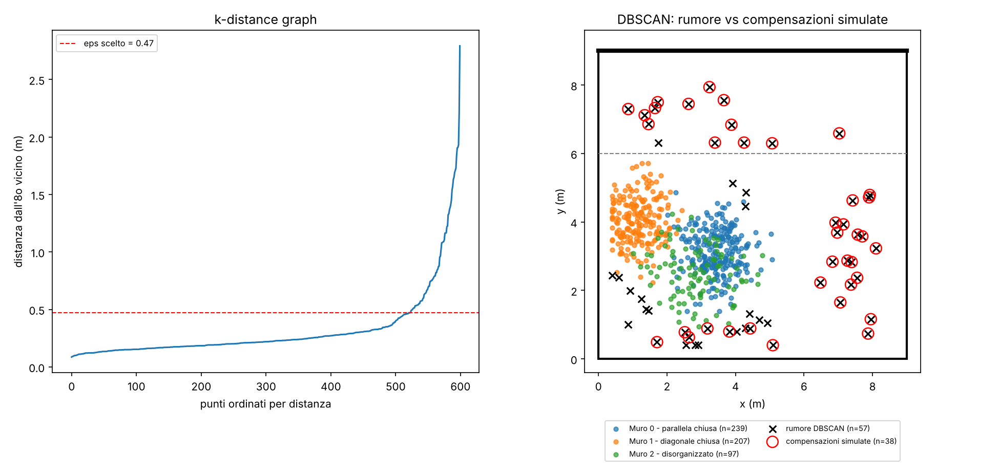
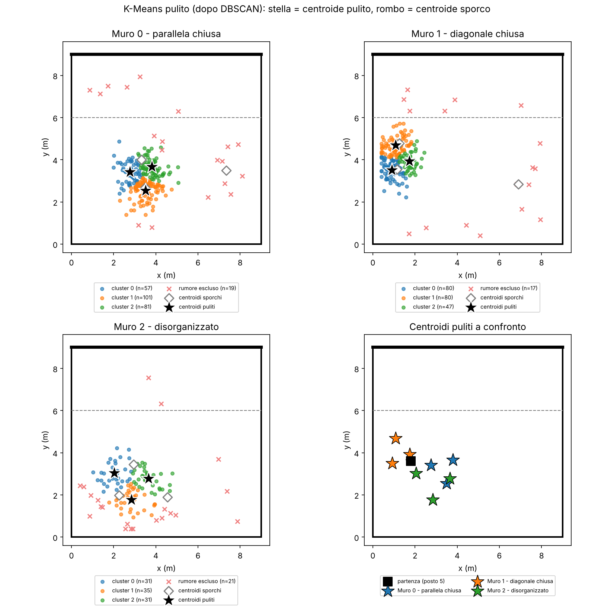

# Analisi spaziale e clustering delle posizioni difensive nella pallavolo

Progetto per il corso di **Principi e Modelli della Percezione**.

Autori: *Lovaglio Alessandro*, *Sala Matteo*

Il progetto modella il posizionamento difensivo del **libero** (partenza in posto 5) al momento del distacco dell'attacco avversario. Durante un'azione d'attacco il libero deve leggere gli indizi visivi (rincorsa e postura dell'attaccante, disposizione del muro) per anticipare la traiettoria della palla e posizionarsi nello spazio. Qui questo processo percettivo-cognitivo viene tradotto in un'analisi computazionale con due algoritmi di clustering non supervisionato:

- **K-Means**, per individuare i baricentri difensivi (centroidi) in funzione del tipo di muro;
- **DBSCAN**, per isolare come rumore (etichetta `-1`)

## Struttura del repository

```
├── src/
│   ├── genera_dataset.py        # generazione del dataset
│   ├── esplora_dataset.py       # controlli di qualità, statistiche, prima mappa
│   ├── kmeans_sporco.py         # K-Means su tutti i punti (confronto)
│   └── dbscan_kmeans_pulito.py  # DBSCAN + K-Means sui punti restanti
├── data/                        # dataset di input e risultati in CSV
├── figures/                     # figure prodotte dagli script
├── requirements.txt
└── README.md
```

## Dataset
**Sistema di coordinate** (metri, campo 9 x 18 m): `x` da 0 a 9, da sinsitra a destra; `y = 0` è il fondo del campo del libero, `y = 9` la rete, `y = 18` il fondo del campo avversario. Il clustering lavora sul solo campo difensivo del libero, **9 x 9 m** (`y` da 0 a 9). L'attaccante è registrato nel campo avversario (`y` da 9 a 18).

| Colonna | Significato |
| --- | --- |
| `id_azione` | identificativo dell'azione |
| `zona_attacco` | scelta del muro: `0` chiude la parallela (il libero si accentra), `1` chiude la diagonale (il libero va verso la linea laterale), `2` muro a un uomo / disorganizzato (posizione di emergenza) |
| `tipo_colpo` | `forte`, `piazzato`, `emergenza` |
| `x_att`, `y_att` | posizione dell'attaccante (variabili di contesto) |
| `x_dif`, `y_dif` | posizione del libero (**variabili target** del clustering) |

La posizione del libero viene registrata in ogni azione difensiva della squadra (approccio sistematico/tattico), così da modellare la copertura spaziale preventiva e non solo i casi in cui il libero tocca la palla.

> `tipo_colpo == "emergenza"` **non** entra nel clustering come feature: è la verità di riferimento della simulazione e serve solo a valutare a posteriori quanto DBSCAN individua le compensazioni.

## Metodo

La pipeline ha quattro passi, da eseguire in quest'ordine:

1. **`genera_dataset.py`** crea `data/dataset_volley.csv`.
2. **`esplora_dataset.py`** esegue i controlli di qualità (valori mancanti, duplicati, coordinate fuori campo), le statistiche descrittive e la prima mappa del campo (figure 01-02).
3. **`kmeans_sporco.py`** esegue il K-Means con `k = 3` (sinistra, centro, destra) **separatamente per ciascun tipo di muro**, su tutti i punti, compensazioni comprese. Scelta di `k` con metodo del gomito e silhouette (figure 03-04). Output: `data/centroidi_kmeans_sporco.csv` 
4. **`genera_dataset.py`** applica DBSCAN a tutti i punti, con `eps` scelto dal ginocchio del *k-distance graph* (`min_samples = 8`). I punti di rumore sono le compensazioni candidate. Poi esegue di nuovo il K-Means per muro sui soli punti restanti e confronta i centroidi "puliti" con quelli "sporchi" (figure 05-06). Output: `data/dataset_dbscan.csv`, `data/centroidi_kmeans_pulito.csv`.

## Come eseguire

Dalla cartella principale del repository:
```bash
pip install -r requirements.txt
python src/genera_dataset.py
python src/esplora_dataset.py
python src/kmeans_sporco.py
python src/dbscan_kmeans_pulito.py
```

I file in `data/` e `figures/` sono già inclusi nel repository, ma vengono rigenerati a ogni esecuzione.

### DBSCAN: individuazione delle compensazioni

Con `eps = 0.47 m` e `min_samples = 8`, DBSCAN marca come rumore **57 punti su 600**. Rispetto alle 38 compensazioni inizialmente individuate, ne cattura **38 su 38** (nessuna mancata), ma produce anche **19 falsi positivi**, di cui 15 nel muro 2.



### K-Means "sporco" e "pulito": traslazione dei baricentri

Il baricentro difensivo medio si sposta in modo netto al variare del muro: il libero si accentra con il muro 0 (`x` media ≅ 3.5 m), va verso la linea laterale con il muro 1 (`x` ≅ 1.5 m) ed è più profondo e disperso con il muro 2 (`y` ≅ 2.4 m).

Nel K-Means sporco, per i muri 0 e 1 le compensazioni formano da sole un cluster (8 punti su 8 e 10 su 10 sono compensazioni): in pratica un centroide viene "sprecato" per i casi d'emergenza e non descrive un vero baricentro difensivo. Dopo la rimozione del rumore con DBSCAN, i tre cluster descrivono invece zone difensive effettive.

| Muro | Baricentro unico sporco | Baricentro unico pulito | Punti usati |
| --- | --- | --- | --- |
| 0 - parallela chiusa | (3.54, 3.24) | (3.43, 3.13) | 239 su 258 |
| 1 - diagonale chiusa | (1.45, 4.03) | (1.16, 4.06) | 207 su 224 |
| 2 - disorganizzato | (2.93, 2.39) | (2.84, 2.49) | 97 su 118 |



Le coordinate complete dei centroidi sono in `data/centroidi_kmeans_sporco.csv` e `data/centroidi_kmeans_pulito.csv`.

## Limiti del modello

- **Scelta di `k`**: `k = 3` è imposto per configurazione del progetto (sinistra, centro, destra). La silhouette, nel K-Means sporco, è massima a `k = 2` per i muri 0 e 1 e non indica un `k` netto per il muro 2: i tre cluster sono quindi una scelta interpretativa più che una struttura evidente nei dati.
- **DBSCAN**: con quelli parametri trova un solo cluster compatto e molti falsi positivi nel muro 2, dove la dispersione normale dei punti è maggiore. Stesso `eps` per tutti i muri è una semplificazione.
- **Sensibilità ai parametri**: `eps` e `min_samples` cambiano molto il numero di punti marcati come rumore (griglia di controllo stampata da `dbscan_kmeans_pulito.py`).